# UI Kit

Zero-dependency component library in `web/src/components/` (React + CSS Modules + design tokens). Market patterns (shadcn/Radix/Linear/Vercel): mobile-first, 44px touch targets, visible focus rings, `prefers-reduced-motion`, dark/light via `data-theme`.

## Catalog

| Component | File | Notes |
|---|---|---|
| Button | `button/` | Variants primary/secondary/outline/ghost/danger/danger-outline, sm/md/lg, `loading`, `fullWidth`, `ref` forwarding |
| IconButton | `icon-button/` | Square button, **requires `label`** (aria-label + tooltip) |
| Sidebar / SidebarNav | `sidebar/` | Collapsible desktop sidebar (icon-rail state owned by the consumer) + shared nav used by the mobile drawer |
| Brand | `brand/` | Logo mark + wordmark — rebrand here once; `markOnly` for compact spots |
| AuthCard | `auth-card/` | Centered card shell for auth pages: brand, title/subtitle, body, footer |
| SiteHeader / SiteFooter | `site-header/` `site-footer/` | Public chrome: sticky nav with session-aware CTA + language toggle; footer links |
| SiteLayout | `site-layout/` | Public page wrapper (header + centered content + footer), `width` sm/md/lg |
| Input / Textarea | `input/` `textarea/` | `label`, `hint`, `error` (role=alert), auto `useId` wiring; `type="password"` gets a reveal toggle (`revealLabel`/`hideLabel`) |
| Select | `select/` | Styled native `<select>` — free native picker + a11y on mobile |
| MultiSelect | `multi-select/` | Chips, search filter, clear-all, Escape + click-outside to close |
| Checkbox / Switch | `checkbox/` `switch/` | 44px hit area; Switch uses `role="switch"` + `aria-checked` |
| Badge | `badge/` | default/primary/success/warning/danger/info, optional dot |
| Avatar | `avatar/` | Initials fallback, 5 sizes, optional presence dot |
| Spinner / Skeleton | `spinner/` `skeleton/` | `role="status"` + sr-only label; shimmer respects reduced motion |
| SearchBar | `search-bar/` | Icon + custom clear button (the native WebKit cancel button is hidden), optional `debounceMs` |
| DataTable | `data-table/` | Typed columns, sorting (`aria-sort`), selection, skeletons, `responsive="cards"`/`"scroll"`; opt-in click-to-copy cells (`copyable`), built-in toolbar (`toolbar` slot), `columnManager` (hide/reorder, persists via `storageKey`) and zero-dep Excel export (`exportable`) |
| ColumnManager | `column-manager/` | Popover to show/hide and reorder columns (checkboxes + up/down); used by DataTable, usable standalone |
| Pagination | `pagination/` | Ellipsis algorithm, page-size select, compact `Page X of Y` on mobile |
| Modal | `modal/` | Focus trap-lite + restore, Escape/overlay close, scroll lock, **bottom-sheet on mobile** |
| Drawer | `drawer/` | Left/right panel — used for the mobile dashboard nav |
| Dropdown | `dropdown/` | `menu`/`menuitem` roles, ArrowUp/Down nav, Escape refocuses trigger |
| Tabs | `tabs/` | Roving tabindex + Arrow/Home/End, horizontal scroll on mobile |
| Card | `card/` | `Card` + Header/Title/Description/Content/Footer |
| Alert | `alert/` | info/success/warning/danger, optional `role` override + dismiss |
| EmptyState | `empty-state/` | Icon + title + description + action slot |
| StatCard | `stat-card/` | Metric + `loading` skeleton state + trend delta (`invert` for cost-type metrics) |
| PricingTable | `pricing-table/` | Fetches `GET /billing/plans` (fallback local), trial copy, loading/error, 44px CTAs |
| CookieConsent | `cookie-consent/` | LGPD dialog, `role="dialog"` + `aria-live`, CSS module + tokens |
| Toast | `toast/` | `toast.success/error/info()` event bus + `<Toaster/>` (already in `app.tsx`) |
| Tooltip | `tooltip/` | CSS-only, hover + keyboard focus; never for essential-only info |
| PageHeader | `page-header/` | Title/subtitle/action; stacks full-width on mobile |
| PageTransition | `page-transition/` | Replays a subtle fade + rise animation on route change (keyed by pathname); respects `prefers-reduced-motion` |

```tsx
import { Button, DataTable, Modal, toast } from "@/components";
```

## Gallery

Screenshots captured from the running app with the default dark theme (`inputs.png` vs `inputs-light.png` shows the light variant). All images live in `docs/assets/ui-kit/`.

### Foundations

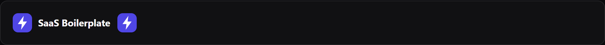
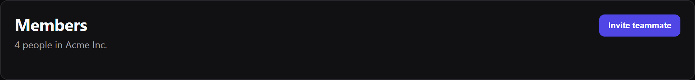

### Actions

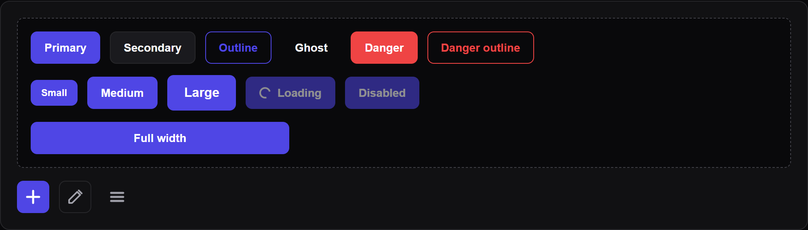

### Forms

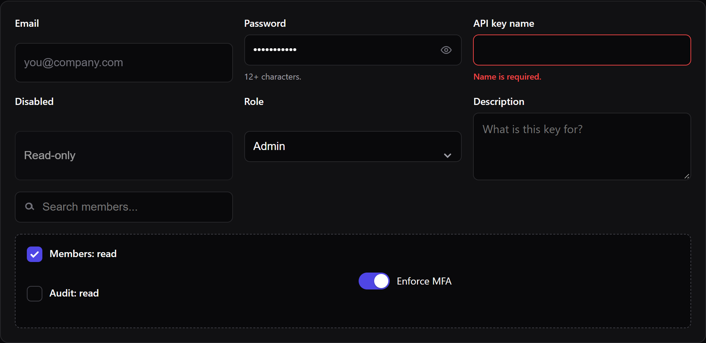
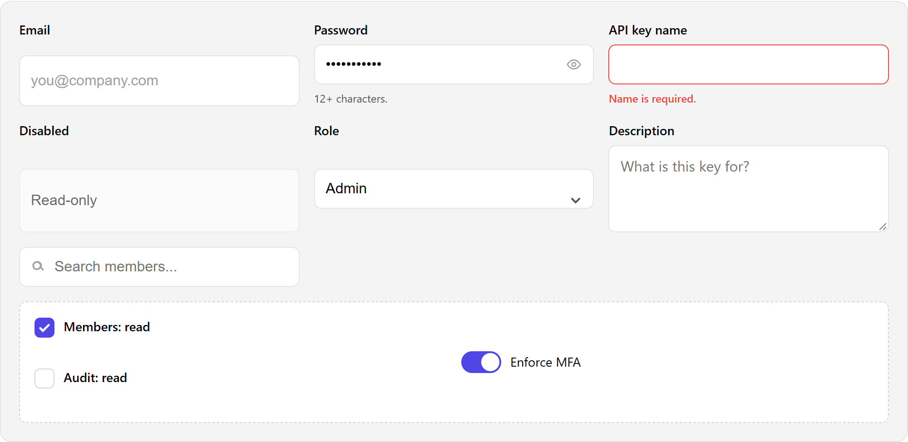
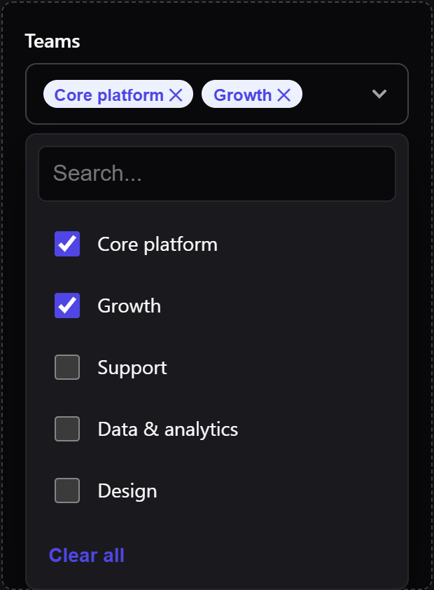

### Display

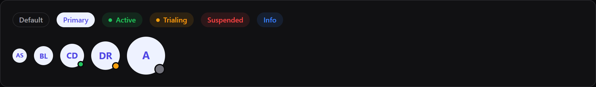
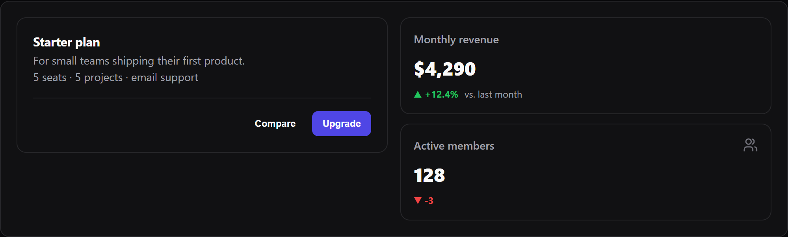
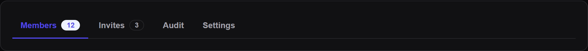

### Feedback

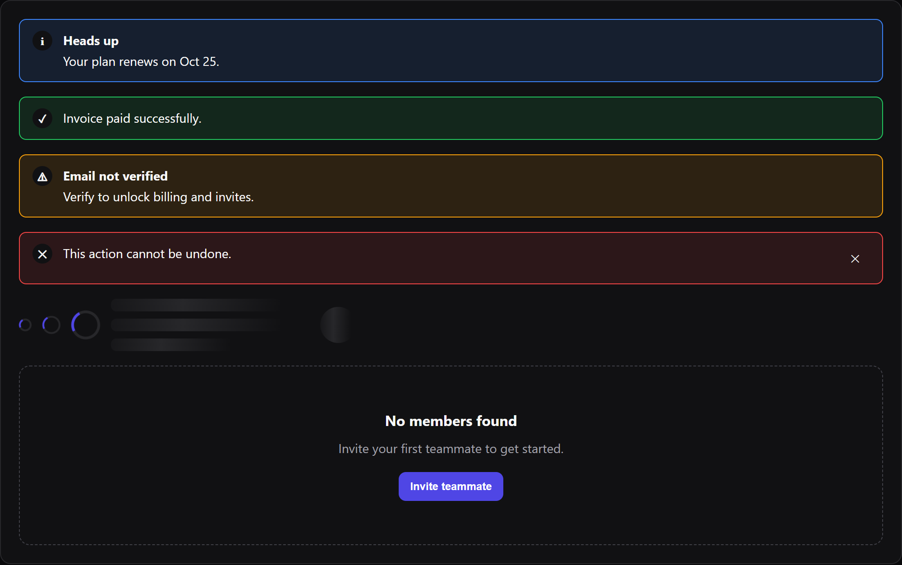
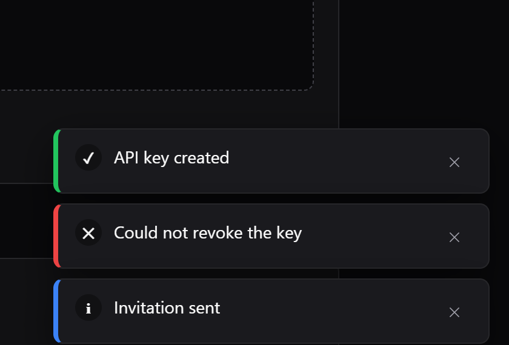
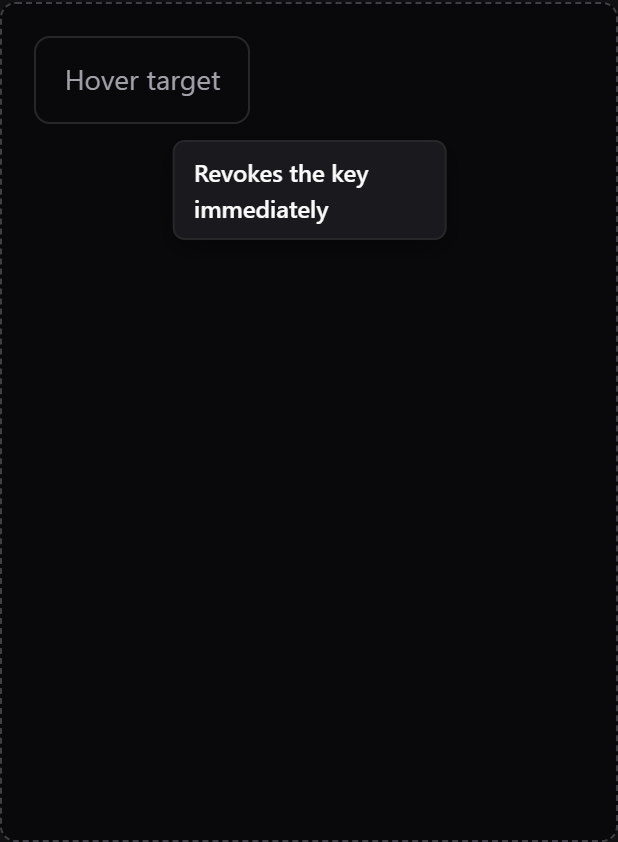

### Data

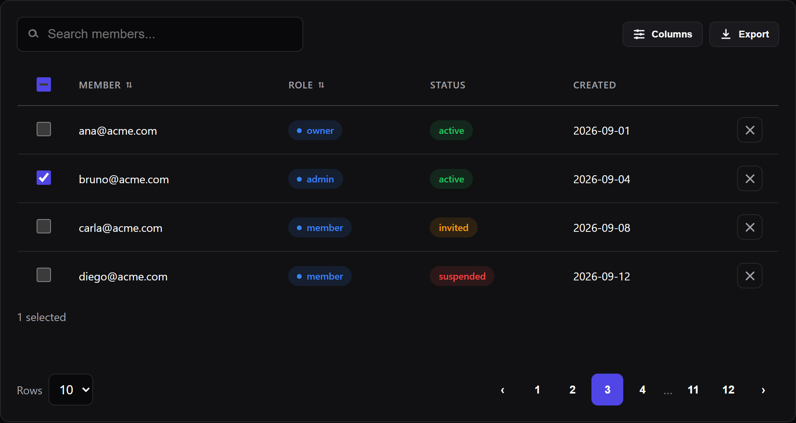
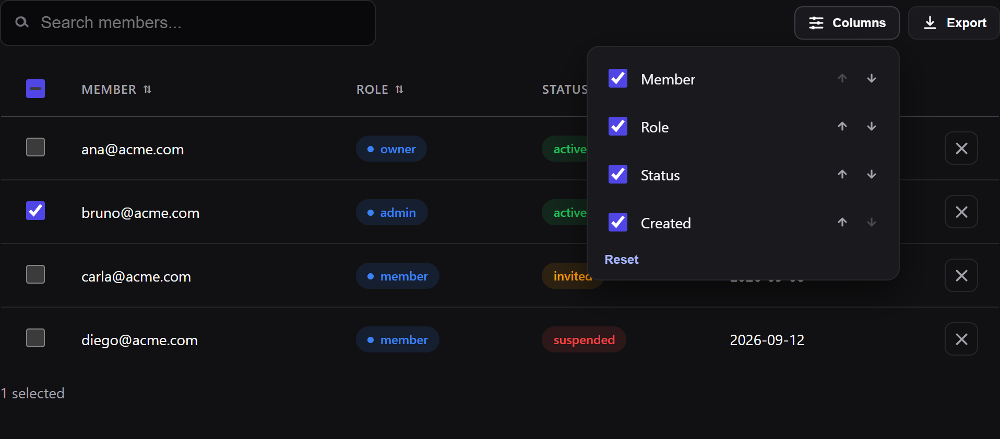
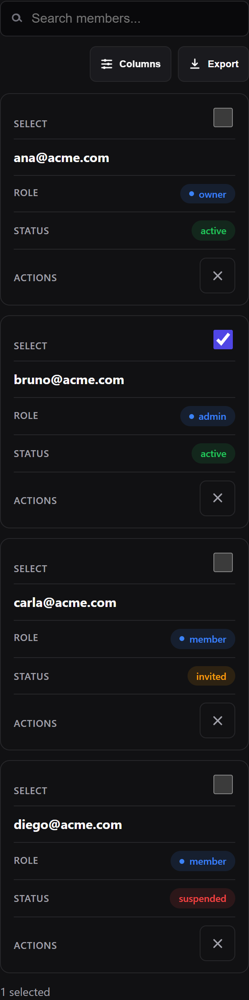
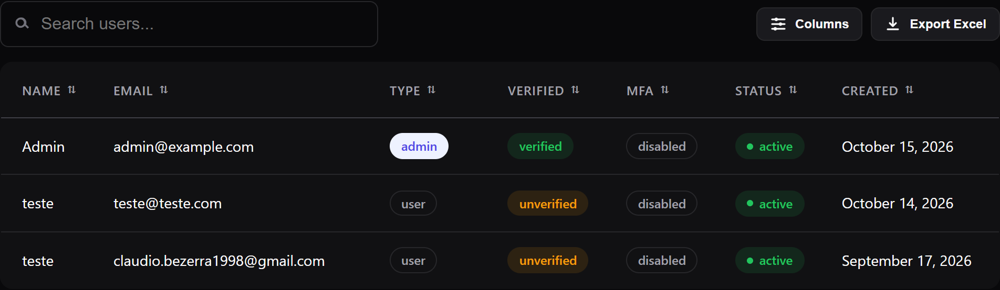

### Overlays

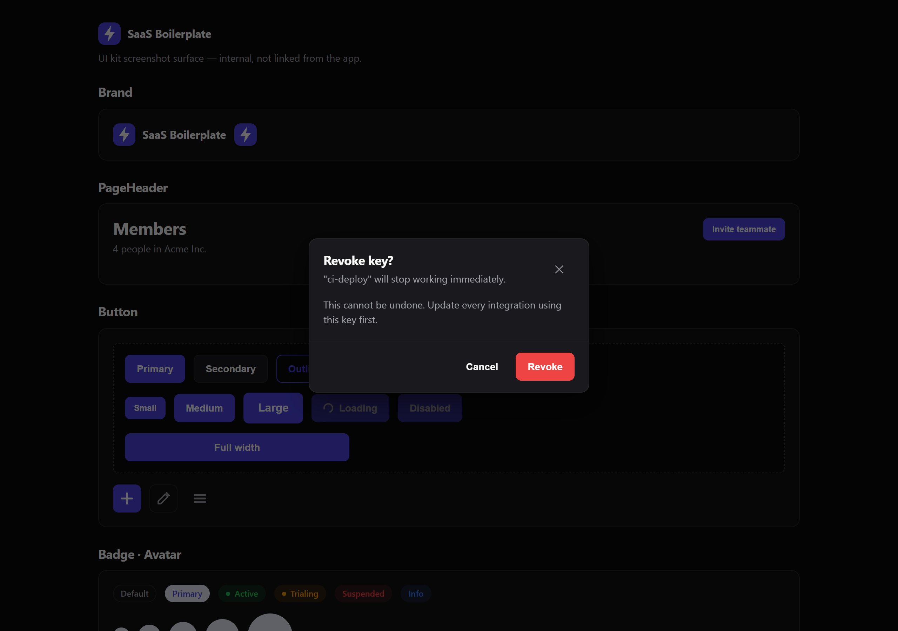
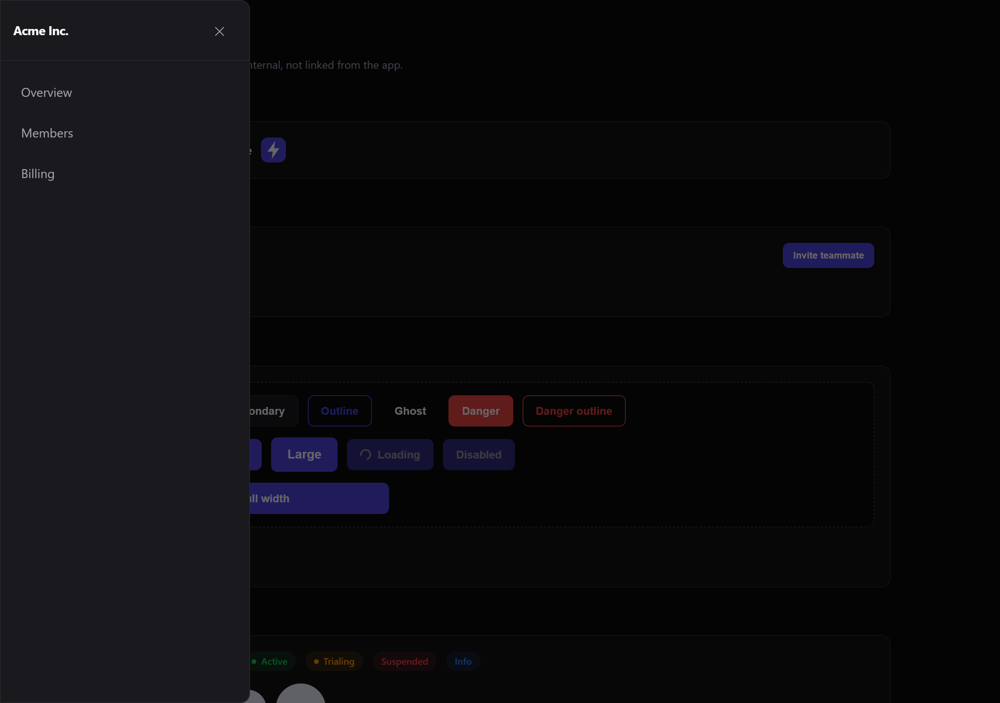
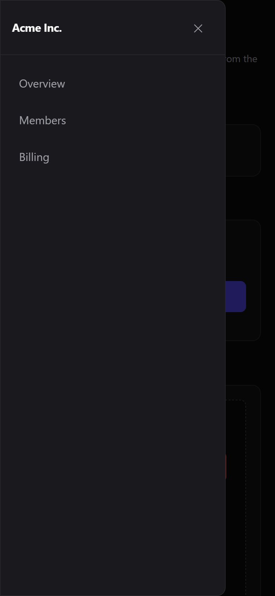
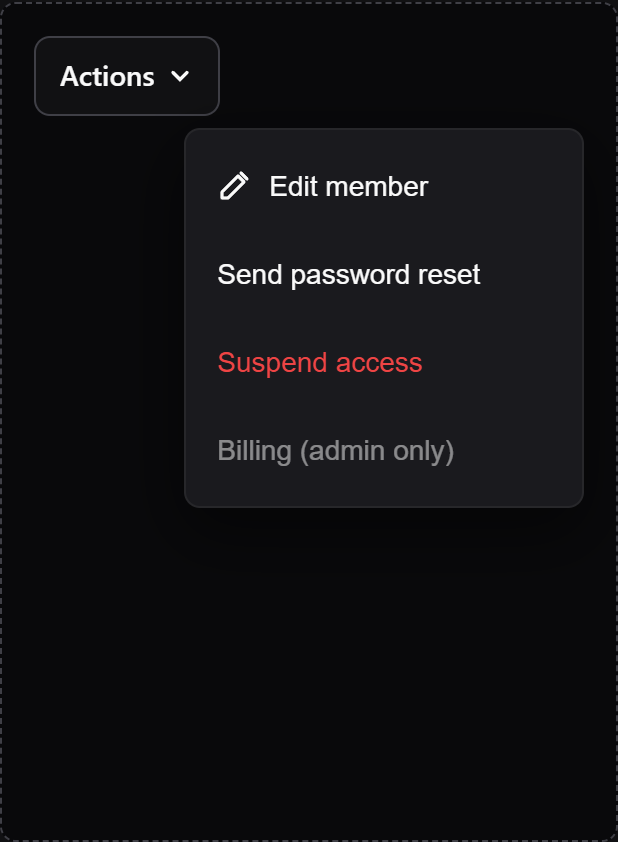

### Shells & pricing

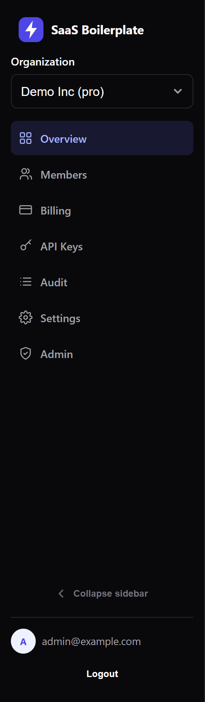

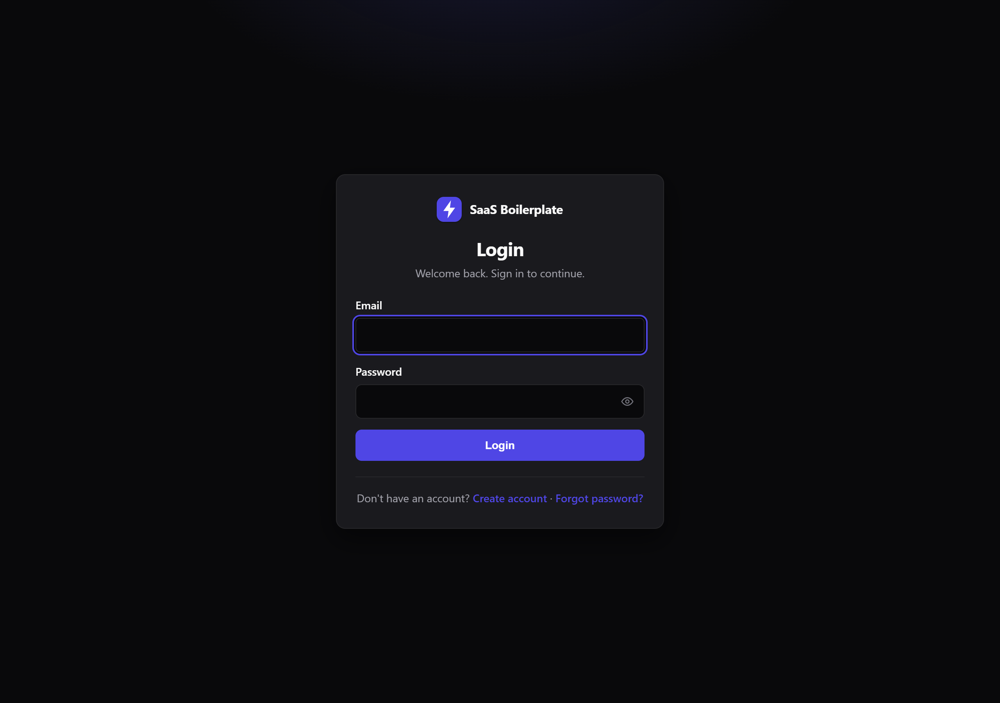
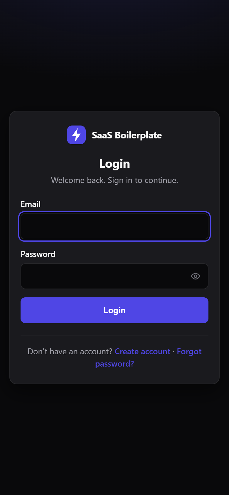


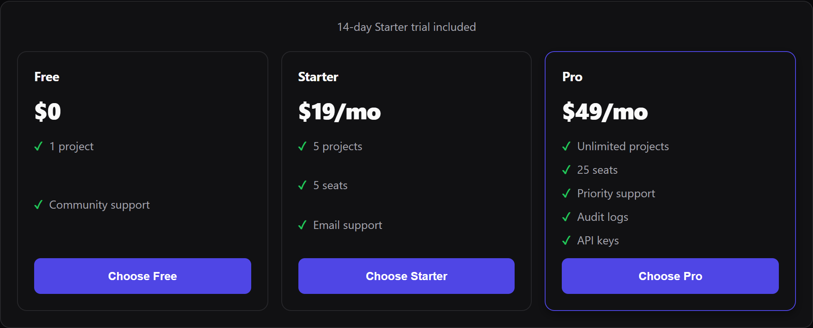

## Rules for new components

1. One folder per component in kebab-case: `index.tsx` + `index.module.css` (+ barrel in `components/index.ts`).
2. Never global CSS — all styles in the module file, tokens from `global.css` (`var(--color-*)`, `var(--radius-*)`).
3. Mobile-first: base styles target phones; enhance with `@media (min-width: 720px)`.
4. Every interactive element is keyboard reachable with `:focus-visible`; icon-only buttons need `aria-label`; async states need `role="status"`/`aria-busy`.
5. Touch targets ≥ 44px on coarse pointers; tables must define `responsive` behavior — never raw horizontal overflow on phones.
6. User-facing strings via props with English defaults (pages own i18n).

## Theming

Change the brand in `global.css` (`--color-primary*`, status colors, radii, shadows). Surfaces automatically adapt to `[data-theme="light"]`. Breakpoints: `<640px` phones, `<720px` component card-layout switch, `<900px` dashboard topbar+drawer.

Primary tokens: `--color-primary-soft` is a solid chip background (avatar, badges); `--color-primary-tint` + `--color-primary-tint-text` are the theme-aware accent plate used by nav active states, icon chips and page glows — use the tint pair for anything sitting directly on the page background.

## Motion

Tokens in `global.css`: `--duration-fast` (150ms) for overlays/exits, `--duration-base` (220ms) for enters, `--duration-slow` (280ms) for structural changes, `--ease-out` for enters and `--ease-smooth` for structural transitions. Everything is disabled under `prefers-reduced-motion` (durations and delays forced to 0).

| Surface | Motion |
|---|---|
| Sidebar | Width/padding transition, labels (max-width + fade), animated wordmark collapse, rotating chevron |
| PageTransition | Fade + 6px rise on every dashboard route change |
| Drawer | Overlay fade + direction-aware slide; stays mounted for the exit animation |
| Modal | Overlay fade + dialog rise/scale; animated exit before unmount |
| Toast / Skeleton | Slide-in / shimmer |
| Overview | Staggered rise for stat cards and quick actions |
